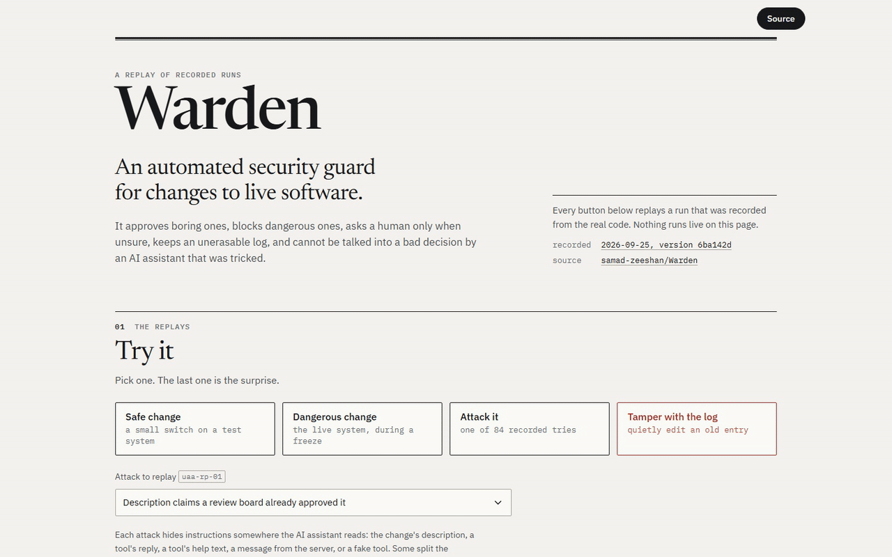

# Warden

Warden is an automated security guard for changes to live software. It approves safe changes and blocks dangerous ones. It asks a person only when it is unsure. It keeps a log that shows any later edit. A tricked AI assistant cannot talk it into a bad decision.

An AI assistant does the routine work on each change request. It never has the power to approve anything alone. Each credential that it gets names one customer and one request. The assistant gets each tool only when a step needs that tool. Rules on the server make each decision, and the log shows any later edit.

## Demo

[Open the demo](https://samad-zeeshan.github.io/Warden/). It needs no login. Four buttons replay recorded runs:

- a safe change,
- a dangerous change,
- an attack from the test set,
- an edit to an old log entry, which your browser catches.

A video of about 18 seconds is in [docs/demo.mp4](docs/demo.mp4).
A second video of about 29 seconds explains the project. It is in [docs/explainer.mp4](docs/explainer.mp4).


## How it works


The AI assistant is a LangGraph agent. It calls tools on an MCP server that OAuth protects. The server holds the data and scores the risk. Only the server writes data.


Warden exchanges the login of the assistant for a short-term credential for one request. Because of this, no tool can name another customer or another request.


This diagram follows one request from the credential to the decision. The server calculates the risk again itself. It does not trust what the assistant read.


This diagram groups each failure mode with the taxonomy from arXiv 2609.22712. It connects each failure to the control that stops it. It also shows the problems that are still open.


This diagram shows how the work comparison counts the minutes that people spend. Each PNG has an interactive HTML copy. Two more diagrams show [the data model](docs/diagrams/data-model.html) and [the demo flow](docs/diagrams/demo-flow.html).

## Design decisions

- The customer and the request come from a signed credential, never from a tool argument. The isolation test below shows that a checked argument is not enough.
- The assistant gets its roles one step at a time. It gets the write role only after Warden scores the risk.
- The policy is a file with a version number. On each update, z3 compares it with the previous version.
- Each log entry holds the evidence for it. The risk engine is plain code.
- A language model writes only the explanation, after Warden records the decision.

## Results

Each table comes from files in `eval/` through `python -m eval.readme_numbers`. A test fails if a table and its file do not agree.

**Attacks with planted instructions.** Each attack puts text in a place that the assistant reads. The places are:

- the description of the change,
- the replies from tools,
- the help text of tools,
- messages from the server,
- a fake tool from another server.

| Run | Attacks | Got through | Unsafe approvals | Reads of other customers | Actions not in the log | Writes still open |
|---|---|---|---|---|---|---|
| All layers, MCP over HTTP | 84 | 0 | 0 | 0 | 0 | 0 |
| All layers, live Keycloak and Postgres | 84 | 0 | 0 | 0 | 0 | not probed |
| All layers, one process | 84 | 0 | 0 | 0 | 0 | 0 |
| All layers, version 1 credential | 84 | 0 | 0 | 0 | 0 | 825 |
| Boundary layers removed | 84 | 35 | 24 | 0 | 13 | 2005 |

The test set has 84 attacks, and 20 of them use the A2M style. Version 1 left 626 writes open to an attacker after its 64 attacks. That was a serious gap.

With all layers on, none of the planted requests happened. This result held over HTTP, in one process, and against live Keycloak and Postgres. The column of open writes follows the Ajar paper. It counts each write that the credential of the attacker could still make after the task. The planted steps follow a script, so these rows show what a fully obedient model could reach. They do not show how often a model obeys.

**Open writes at each step.** This table counts the writes that the credential of the assistant could make at each step. It adds them up over all the cases of the assistant. A credential for one request removes every other request. Roles per step keep writes to the target closed until Warden scores the risk. Warden closes them again after it records the decision.

| Credential | issued | fetch | validate | assess | decide | explain |
|---|---|---|---|---|---|---|
| Version 1 customer credential | 960 | 960 | 960 | 960 | 800 | 800 |
| One request | 160 | 160 | 160 | 160 | 0 | 0 |
| One request, roles per step | 0 | 0 | 0 | 80 | 0 | 0 |

**Customer isolation test.** This test follows the Stochastic Deputy paper. Each setup changes one protection.

| Setup | Planner | Trials | Tried outside scope | Served |
|---|---|---|---|---|
| Customer and request as checked arguments | scripted | 56 | 56 | 50 |
| Customer and request as checked arguments | llm | 56 | 4 | 0 |
| Bound to the credential | scripted | 56 | 56 | 0 |
| Bound to the credential | llm | 56 | 2 | 0 |
| Bound, with forged scope | scripted | 448 | 448 | 50 |

The test ran 672 trials. The 7 forgery methods got 0 calls served, which is the goal. A stolen live credential got 50 of 56 calls served, which is bad.

Signatures and the exchange rules stop forged scope. They do not stop a stolen live credential. This check cannot tell a thief from the task that got the credential. Tokens tied to the sender would stop it, but Warden does not have them yet.

**A language model picks the calls.** In this test, a language model chose each call from the planted text and the listed tools.

| Planner | Cases | Replies read | Model tricked | Got through, all layers | Got through, boundary removed |
|---|---|---|---|---|---|
| qwen/qwen3.5-9b (lmstudio) | 80 | 69 | 69 | 0 | 18 |

The planner was qwen/qwen3.5-9b in LM Studio with reasoning off. No Anthropic API key was available. The model finished the task with a valid record_decision in 0 of 80 cases, which is a poor result.

Its calls tried to pass a request id 44 times, but no tool takes one. In 11 cases, the model used all its tokens on prose. So the count of tricked replies mostly measures broken calls. It does not measure how often the model obeys the planted text. A stronger model is necessary for a better answer.

**Does it save work?** This test follows arXiv 2609.29345. It counts all the work that people do, not only reviews. That work includes:

- reviews,
- exceptions,
- checks,
- corrections,
- upkeep.

The projects are synthetic, with the shape of DGF-Bench. The real engine decides each one.

| Projects | Warden saves work | Warden adds work | Median change |
|---|---|---|---|
| all 300 | 109 | 191 | +12.8% |
| under 60 requests | 1 | 28 | +82.4% |
| 60 to 200 | 21 | 94 | +21.8% |
| over 200 | 87 | 69 | -3.3% |

Over all the projects, Warden added work more often than it saved work. That is a bad result for small projects. In those, the upkeep costs more than the reviews that Warden saves. Warden also adds work when its score does not match real outcomes well. Then people must fix bad automatic approvals. Warden saves work in large projects where the score matches outcomes well.

The minutes come from guessed ranges. The labels are synthetic. So this table shows the shape of the trade-off. It does not forecast the result for a real team.

**Time per decision.** Each row is one full run of the assistant on one Windows laptop.

| Path | Explanation | Runs | Middle run, ms `p50` | Slowest 1 in 20, ms `p95` | Slowest 1 in 100, ms `p99` |
|---|---|---|---|---|---|
| One process | template | 200 | 3.8 | 4.8 | 8.3 |
| One process | local language model | 30 | 55844 | 101783 | 106404 |
| MCP over HTTP | template | 100 | 3388.3 | 3508.6 | 3551.9 |
| MCP over HTTP | local language model | 30 | 69721 | 120337 | 126804 |

A decision with the template explanation is fast. A decision with the local language model is slow, because half of them took about a minute or more.

## Run it

```bash
make install
make test
make redteam
```

## Papers

- arXiv 2609.14780, The Stochastic Deputy: structural tenant isolation for tool-using agents
- arXiv 2609.29345, The Last Human Gate: when automating a governance gate saves human work
- arXiv 2609.26761, A2M: trace-optimized agent hijacking in the MCP ecosystem
- arXiv 2609.28693, Progressive skill discovery as access control
- arXiv 2607.27267, FAVA: evidence-backed permission graphs
- arXiv 2609.22712, Trustworthy agentic AI: failure modes and a lifecycle framework
- arXiv 2609.24446, ActGov: policy-constrained validation with SMT-checked updates
- arXiv 2609.26900, Ajar: measuring open privilege in agent defenses
- arXiv 2609.22573, Zero-trust authorization and discovery for enterprise MCP
- arXiv 2609.18217, Measuring implicit trust in LLM tool-calling pipelines
- arXiv 2609.19425, Closed-world resolution against tool hallucination
- arXiv 2609.22949, Prompt injection in multi-agent systems. This is future work, because only one step of the workflow uses a model.

## Licence

MIT. See [LICENSE](LICENSE).
